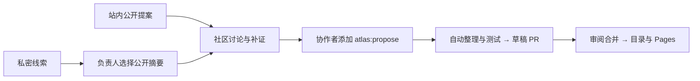

# SAFETY ATLAS · 越界档案

**人类掌舵。发现越界，连接解法。**

一个可以探索、演示、投稿的智能体安全观测站。

[进入观测站](https://utopiazzr.github.io/safety-atlas/) · [免登录投稿](https://utopiazzr.github.io/safety-atlas/#contribute) · [参与指南](docs/CONTRIBUTING.md) · [安全边界](SECURITY.md)

## 从真实材料出发

| 发现异常                                                      | 理解方法                           | 连接防御                                    |
| ------------------------------------------------------------- | ---------------------------------- | ------------------------------------------- |
| EchoLeak · SpAIware · WhatsApp MCP 工具投毒                   | GCG · PAIR · garak                 | NeMo Guardrails · Prompt Guard 2 · MCP-Scan |
| 时间、版本、权限、信息流与原始披露                            | 访问条件、目标模型、预算、研究局限 | 接入位置、配置、评测范围、模型卡            |
| [探索案例](https://utopiazzr.github.io/safety-atlas/#signals) | [资料与分类](docs/RESEARCH.md)     | [查看可审数据](data/signals.json)           |

九个来源可追溯的初始条目，关联论文、通告、代码、模型与工具。科幻插画承载浏览入口，交互分镜解释数据如何越界、工具如何被误用、防御在哪一步介入。

**来源可追溯不等于本站独立复现。** 研究 PoC、历史披露、厂商通告与现实事故分别描述。动画是机制示意，不能代替证据。

## 直接在网站提交

- **一句怀疑也能投**：观察、链接、代码、图片、视频，可混合提交；分类可选。
- **项目不用搬家**：关联仓库 / Hugging Face / Release，附固定版本和重点路径；也支持文件夹与压缩包。
- **上传可以继续**：8 MiB 分块，单文件 512 MiB、单次 1 GiB、最多 100 文件。保存回执后可恢复上传、查进度、补充或撤回待审材料。
- **免登录，有边界**：公开提案由投稿者单独确认后进入社区，私密线索先审阅；原始附件保持私有。防刷校验与限额适用于两条入口。
- **浏览轻一点**：中英文、搜索筛选、收藏、关联资源、暂停与时间轴、移动端和减少动态效果。

[现在投递 →](https://utopiazzr.github.io/safety-atlas/#contribute)　[GitHub 备用入口](https://github.com/utopiazzr/safety-atlas/issues/new?template=signal.yml)

## 一条材料如何成为档案

## 云端系统

| 组件                        | 职责                                        | 源码 / 入口                                                                                                                |
| --------------------------- | ------------------------------------------- | -------------------------------------------------------------------------------------------------------------------------- |
| GitHub Pages                | 公共网站、案例、机制动画、投稿界面          | [src/](src/)                                                                                                               |
| Sites Worker + D1 + 私有 R2 | 匿名接收、分块文件、回执、限额、审核        | [cloud/](cloud/) · [维护者接收台](https://safety-atlas-intake.aurora-scarf-6347.chatgpt.site/admin)                        |
| GitHub Actions              | OIDC 同步公开提案、生成草稿、清理与部署 | [工作流](.github/workflows/)                                                                                               |
| GitHub Issues / PR          | 公开讨论、证据快照、可追溯变更              | [公开摘要](https://github.com/utopiazzr/safety-atlas/issues) · [审核变更](https://github.com/utopiazzr/safety-atlas/pulls) |

使用与维护均在云端进行，不需要本机常驻服务或下载模型。正文和附件在点击提交后上传。未完成上传保留 24 小时，完成后的原始材料保留 30 天，由定时任务清理；公开提案与审核摘要持续保留。回执是访问凭证，请私下保存。

## 一起建设

| 你拥有的材料              | 可以贡献什么                                 |
| ------------------------- | -------------------------------------------- |
| 可疑现象、截图、报道      | 保留不确定性，提供时间、环境与出处           |
| 攻击论文或代码            | 原始来源、访问条件、模型版本、评测和局限     |
| Guardrail、检测模型或产品 | 适用位置、接入方式、配置与有效性证据         |
| 更正、补证、维护建议      | 从已有档案发起，保留关联记录                 |
| 设计与代码                | 改进分镜、无障碍、语言和易用性，通过 PR 审阅 |

[投稿与审核指南](docs/CONTRIBUTING.md) · [云端运维](docs/CLOUD.md) · [视觉研究](docs/DESIGN.md) · [资源与插画记录](docs/ASSETS.md)

## 当前边界与下一步

已实现免登录公开提案、私密线索、大文件接收、社区讨论、标签触发的草稿 PR 与合并发布。协作者复用投稿字段，无需在后台与 GitHub 重复填表。模型分镜接口已预留，**尚未配置模型服务，不调用付费模型**。自动抓取外部网页、媒体识别、项目沙箱执行和完整恶意文件扫描尚未实现；投稿代码不会自动执行。

站点已加入权限校验、上传限额与工作流隔离。这些措施不代表系统不存在漏洞。负责披露与部署要求见 [SECURITY.md](SECURITY.md)。

## 开发

Node.js 22.13+（后端测试推荐 24）：`npm ci`、`npm test`、`npm run build`。预览用 `npm run dev`。后端在 `cloud/` 单独安装、测试和构建；部署需要自己的 Sites 项目、存储与服务端环境配置。Fork 不应复用原站接收地址或项目 ID。日常参与直接使用网站即可。
