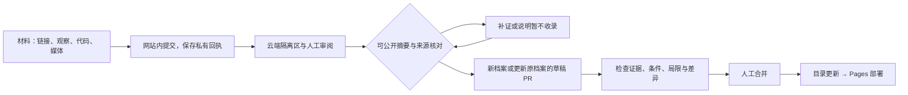

# 从材料到档案 / From material to catalogue

网站接受尚不完整的观察、报道、代码、图片、视频、论文、模型与产品。原始材料先进入私有接收区；维护者选择可公开摘要，审核通过才进入目录。来源可追溯不代表本站独立复现。

Start with one material. A submission is evidence to examine, not a verified conclusion. Original materials are private by default; only curated summaries become public. The catalogue is curated through reviewed pull requests.

## 投稿者只需要交材料

1. 在网站输入观察、粘贴链接或代码。可选分类与运行条件；不确定时保留“有点可疑”。
2. “检查并继续”查看交接内容，再到 GitHub 登录、检查并创建 Issue。网站打开 GitHub 不代表已提交。
3. 图片与视频目前只在本机预览。请在 GitHub 编辑框附上原文件，等待生成附件链接，再删除“尚未上传”的提示。GitHub 的文件类型和大小限制以平台提示为准。
4. 长内容先复制全文或下载 Markdown，再在 GitHub 替换模板提示；不会静默截断。超过 GitHub 正文限制时，使用公开脱敏文件链接并保留摘要。
5. 已有档案可直接点击“补充线索”或“更正信息”，原档案 ID 会带入。无需为同一事件再造一张卡。

没有 GitHub 账户时可保存本机草稿或导出；公开投稿目前需要 GitHub 账户。现阶段不提供匿名写入接口，也不把个人访问令牌交给网页。

**公开之前先脱敏。** 尚未公开的漏洞，应先走受影响项目的私密披露渠道。本项目没有私密附件库。不要上传个人聊天原文、密钥或能直接识别受害者的数据。代码作为材料展示，平台不执行社区提交的代码。

## 三组概念独立记录

| 维度       | 字段                           | 含义                                                                        |
| ---------- | ------------------------------ | --------------------------------------------------------------------------- |
| 投稿意图   | `intake.intent`                | 新线索 / 补证 / 更正                                                        |
| 材料对象   | `kind`、`resources[].type`     | 案例、攻击、防御、模型产品；一条中可混合论文、仓库、模型卡、视频和代码      |
| 来源与核验 | `evidenceType`、`verification` | 来源类型与核验结论独立；研究 PoC 不是现实受害事件，项目存在不是效果已获验证 |

网站原始材料保留在私有接收区。维护者选择的公开摘要和来源进入 Issue；GitHub 备用入口提交的内容会直接公开。目录记录是维护者整理的摘要和条件，不直接复制投稿者标题为事实结论。每次社区来源的目录变更保留 Issue、证据快照哈希、整理人、时间和判断理由。

## 按真实材料选择核对重点

| 真实对象                                                                                                            | 产品应记录                                                    | 容易误导的展示                          |
| ------------------------------------------------------------------------------------------------------------------- | ------------------------------------------------------------- | --------------------------------------- |
| [SpAIware 原始披露](https://embracethered.com/blog/posts/2024/chatgpt-macos-app-persistent-data-exfiltration/)      | 历史 macOS 应用、持久记忆机制、研究演示、作者说明的修复范围   | 把历史 PoC 当成今天所有版本都在泄露数据 |
| [PAIR 论文](https://arxiv.org/abs/2310.08419)                                                                       | 攻击者/目标模型、黑盒访问、迭代预算、评测条件；关联论文与代码 | 将研究成功率泛化成任意模型保证成功      |
| [NeMo Guardrails](https://github.com/NVIDIA-NeMo/Guardrails)                                                        | 接入位置、配置、策略和评测；代码仓库属于资源                  | 把安装工具描述成已经消除风险            |
| [Prompt Guard 2 模型卡](https://github.com/meta-llama/PurpleLlama/blob/main/Llama-Prompt-Guard-2/86M/MODEL_CARD.md) | 模型版本、分类用途、适用语言与能力边界                        | 把检测模型当成整个智能体的权限系统      |
| 同一事件的多篇报道                                                                                                  | 一个档案、多个来源、后续修正                                  | 把多篇报道计为多个独立事件              |
| 一张可疑截图                                                                                                        | 保留观察与“不确定”，追问上下文、时间、版本与原始材料          | 因为截图存在就自动标记 verified         |

数据结构可容纳这些对象；关联关系必须人工选择。`mitigates` 不是通用“推荐防御”标签，需要给出针对性证据、配置和适用范围。目前自动关联只建议同源或明确提到的档案，不自动合并。

## 站内提交与大项目

[网站投递](https://utopiazzr.github.io/safety-atlas/#contribute)无需登录。粘贴观察、链接或代码，选择文件或项目文件夹，通过防刷校验后提交。项目可提供仓库 / 模型页 / Release 链接、固定版本、重点路径，不必上传依赖目录或模型权重。

文件以 8 MiB 片段上传，单文件 512 MiB、单次 1 GiB / 100 文件。提交后保存 JSON 回执；它包含私有访问凭证，请勿上传到公开 Issue。导入回执可查进度、续传（重新选择同一批文件）、补证或撤回待审材料。附件保留 30 天，未完成上传保留 24 小时。

需要 GitHub 原生协作时，可用备用 Issue 入口；该入口直接公开，请只放脱敏内容。维护者手动运行接收任务或添加 atlas:triage 标签后才触发自动整理。

网站接收台的负责人先审阅原始材料，再填写可公开摘要。Cloud intake bridge 每小时导入已审摘要，也能手动运行；所有导入仍需下述目录审核。原始附件不会随摘要同步到 GitHub。

## 维护者云端操作

入口：[Review community signal](https://github.com/utopiazzr/safety-atlas/actions/workflows/review-signal.yml)。需要仓库写入权限。选择默认分支，点击 Run workflow。

| decision       | 必填与作用                                                                                   |
| -------------- | -------------------------------------------------------------------------------------------- |
| `request-info` | Issue 编号和 rationale；提出具体缺失信息，保留线索                                           |
| `duplicate`    | 编号、已存在的 target_id 和理由；真正有新证据请用 draft-update                               |
| `decline`      | 编号和理由；不删帖，可继续补证和申诉                                                         |
| `draft-new`    | 编号、准确 title/summary、evidence_type、核对过的 source_url、理由；填写 context/limitations |
| `draft-update` | 编号、target_id、source_url、理由；summary 留空保留原摘要，填入则替换；补充资源与来源        |

工作流先收集正文与评论，生成候选和检查提示，再运行测试、构建。成功后创建独立分支和 **draft PR**，不自动合并。若仓库禁止 Actions 创建 PR，运行摘要提供已生成分支的 compare 链接，维护者在 GitHub 手动创建即可；无需在聊天或前端放令牌。

草稿 PR 中的 `review: approved` 是拟发布数据格式，**真正的发布决定是维护者审查并合并 PR**。审核者仍需检查分类、来源、摘要、环境、局限、关系和翻译；有歧义应退回补证。自动检查只验证结构和证据快照，不能判断科学结论是否成立。

现有候选准备工作流 [Prepare community signal](https://github.com/utopiazzr/safety-atlas/actions/workflows/prepare-signal.yml) 仍可下载候选及 review.json。评论超过 20 条、单条超过 8000 字符、链接超过 19 个或资源超出候选容量时，会标记部分摘录并停止自动生成发布提案；请阅读完整 Issue 后手工整理 PR。证据哈希覆盖读取到的全部人类评论；超过 1000 条评论要求手工整理。

### 审核和发布边界

- `source-linked` 只表明来源已关联。要使用 `verified`，必须提供 `reproduction.url` 指向独立复现记录，并人工审查其质量。
- 更正或摘要变化会清除旧分镜并标记 `visualizationStatus: needs-review`。更新机制与 `src/scenes.ts` 后，明确移除该标记，才能重新展示动画。不要让旧动画继续支撑新结论。
- Issue 正文或人类评论在拟稿后变化，审核快照会失效。接收工作流对相关未合并 PR 写入失败的 `Atlas evidence snapshot` 状态；应重新运行 Review community signal，审查新分支并关闭旧 PR。
- 默认分支在生成候选期间更新，工作流停止，避免覆盖并发编辑。重新运行以合并最新目录。
- GitHub 当前会让 GITHUB_TOKEN 创建/更新 PR 所产生的工作流进入等待批准状态；维护者可在 PR 点击 Approve workflows to run。创建分支之前也已测试与构建。可手工运行 Validate catalogue 检查候选分支，但手动运行不能替代规则要求的 PR 检查。建议仓库规则要求审核与相应检查；这些规则尚未由本次代码自动配置。见 [GitHub 官方说明](https://docs.github.com/en/actions/concepts/security/github_token)。
- 合并目录变更后同步 Issue 的 `atlas:published`。它表示**已进主分支目录**；网页还要等 Pages 工作流部署成功。投稿 Issue 不自动关闭，后续证据可继续讨论。
- 如果需要撤销目录条目或更正错误关系，通过新的审核 PR 修改。不要为了通过校验伪造来源或复现记录。

## 状态与管理

`atlas:received` 已接收 → `atlas:needs-info` 待补证 / `atlas:in-review` 整理中 → `atlas:published` 已进目录。

旁路：`atlas:duplicate` 已关联、`atlas:declined` 暂不收录。状态不等于事实核验等级。机器人只管理 `atlas:` 前缀的状态标签，保留其他人工标签。网站的进度面板按需读取最近公开 Issues；限流或失败时提供 GitHub 原生入口，不显示伪造数量。

## 模型与基础设施

运行架构：Pages 静态站 + Issues 材料与讨论 + Actions 接收/整理/测试 + Git PR 审核记录。无需本机常驻服务、数据库或下载模型。

模型配置仍预留 `ATLAS_MODEL_BASE_URL`、`ATLAS_MODEL_ID`、Secret `ATLAS_MODEL_API_KEY`。未配置时不调用模型。只允许维护者主动运行的准备工作流调用兼容服务；不在收到投稿时消耗模型额度，不自动抓取未知 URL，不执行提交的代码。模型生成分镜始终待审，不自动进入目录。

以后只有在出现匿名投稿、私密披露、大文件托管或高频协作需求时，才另加经过鉴权的云端 API 与对象存储；目前不把这些能力伪装成已经实现。
