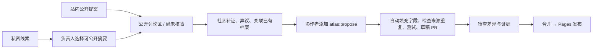

# 共同维护 Safety Atlas

公开项目的贡献模型：**任何人提出改动，社区讨论和补证，协作者整理，维护者审阅合并。** 提案不等于事实已核验，合并不等于独立复现。

## 两种站内投稿

| 方式     | 适合什么                                                   | 公开边界                                                                          |
| -------- | ---------------------------------------------------------- | --------------------------------------------------------------------------------- |
| 公开提案 | 已公开的报道、研究、代码、模型、防御工具；新增、补证、更正 | 单独勾选公开许可后，只有标题、说明、来源、分类、条件与局限公开；自动同步到 GitHub |
| 私密线索 | 尚不完整的怀疑、包含需先脱敏材料的观察                     | 原始文字、代码、附件留在私有接收区；负责人选择摘要并明确批准后才公开              |

两种方式都可在[网站](https://utopiazzr.github.io/safety-atlas/#contribute)免登录提交，有防刷校验与限额。公开提案的私密附件也不会随提案公开。历史私密投稿不会自动转为公开提案。公开内容可能被转存，撤回不能删除他人保留的副本。

文件按 8 MiB 分块上传，单文件 512 MiB、单次 1 GiB / 100 个文件；大项目优先提供仓库、模型或 Release 链接与固定版本。保存私有回执可恢复上传、查进度、补充私密线索或撤回尚未导入 GitHub 的提案。回执内有访问凭证，切勿公开。未完成上传保留 24 小时，原始材料完成后保留 30 天；公开提案与审核摘要持续保留。

## 从提案到目录

Cloud intake bridge 约每小时同步一次（GitHub 调度可能延迟），也可手动运行。公开提案立即出现在网站“共同维护”区，不需要先等站长批准。GitHub 讨论需要 GitHub 账户；站内投稿不需要。

任何人可以评论补证、指出错误、Fork 后直接提交 PR。已有案例请从案例详情的“补充证据 / 更正信息”发起，保留原档案 ID。尚未核实的截图应写“观察 / 怀疑”，不把研究 PoC 描述为真实受害事件。

## 协作者不用重复填表

1. 阅读 Issue 的公开快照、来源、补充评论和适用条件。
2. 有仓库 triage / write / maintain / admin 角色的协作者，可添加 **`atlas:propose`** 标签；也可运行 [Curate public proposal](https://github.com/utopiazzr/safety-atlas/actions/workflows/community-curate.yml)，只填 Issue 编号。
3. 自动化复用公开字段，运行测试与构建，创建草稿 PR。补证保留原摘要，更正会使旧动画失效；同源新提案会停止自动建卡，交由协作者选择关联对象。一次 Issue 同时只保留一份自动创建的开放草稿 PR。
4. 审查差异、分类、条件、局限、来源与评论。必要时修改 PR 或要求补证，再由有合并权限的维护者合并。

普通访客不能添加触发标签，也不能直接写入 main。后台通过 GitHub API 检查操作者角色；自动化仅从 main 运行，不拉取或执行投稿者的项目。自动校验能检查格式、权限与证据快照，不能判断结论是否真实。云端私密附件仍只向指定负责人开放，仓库协作者不自动获得附件权限。

自动草稿使用拟发布的 `review: approved` 数据格式；它存在于独立分支，**最终发布决定是审阅与合并**。`source-linked` 仅表示来源可追溯；`verified` 必须有独立复现记录 `reproduction.url`。没有根据投稿票数或标签自动授予核验等级。

若 Actions 创建 PR 被仓库设置禁止，工作流仍生成已测试的分支，并在运行摘要提供创建 PR 的 compare 链接。设置入口为 Settings → Actions → General → Workflow permissions → Allow GitHub Actions to create and approve pull requests；不要因此给匿名访客仓库令牌。

## 直接贡献代码与档案

遵循 [GitHub 的 Fork → 分支 → PR 协作流程](https://docs.github.com/en/get-started/exploring-projects-on-github/contributing-to-a-project)，类似 [garak 的社区贡献方式](https://reference.garak.ai/en/stable/contributing.html)。

- 数据：修改 `data/signals.json`，附可核对的一手来源、环境与局限。
- 资料：攻击、防御、模型、产品可以混合关联论文、仓库、模型卡、媒体，不必上传整套依赖或权重。
- 设计与代码：改进分镜、语言、可访问性与易用性。Fork 的 CI 使用受限权限，不向外部 PR 提供云端密钥。
- 本地验证：Node.js 22.13+，`npm ci --ignore-scripts`、`npm test`、`npm run build`；云端服务测试用 Node.js 24，在 `cloud/` 独立运行。日常贡献无需本地常驻任何服务。

## 异常与管理

需要重新分类、修改公开摘要、关联重复记录、拒收或要求补证时，使用 [Review community signal](https://github.com/utopiazzr/safety-atlas/actions/workflows/review-signal.yml)。该入口保留完整编辑能力。

私密接收台默认只列出待审 / 待补证材料。负责人可以在“全部投稿与公开提案”中隐藏不当提案，理由记入审计；已同步的 GitHub Issue 需在 GitHub 标记、关闭或按平台规则处理。社区成员可在对应 Issue 提出异议。尚未公开的漏洞优先使用受影响项目的私密披露渠道，见 [SECURITY.md](../SECURITY.md)。

`atlas:received` → `atlas:needs-info` / `atlas:in-review` → `atlas:published`；旁路为 `atlas:duplicate` / `atlas:declined`。机器人只清理这些状态标签，保留 `atlas:propose` 等协作标签。状态代表处理进度，不代表核验结论。

Issue 内容变化会使证据快照失效；默认分支变化会阻止旧基线创建变更。重新拟稿前关闭旧草稿，或手工整理更新。不要为了通过检查伪造来源。main 的保护规则要求 PR、必需检查和已解决的审阅对话，禁止强推与删除。当前单维护者阶段不强制另一人批准，避免本人 PR 无法合并；社区扩展后再增加独立审核人数。分支保护不能替代事实核验。

## 已实现与预留

Pages 展示 + 云端接收 / 私有存储 + GitHub Issues 讨论 + PR 审阅 + Actions 同步、测试、部署。全部运行在云端。

模型参数 `ATLAS_MODEL_BASE_URL`、`ATLAS_MODEL_ID` 和 Secret `ATLAS_MODEL_API_KEY` 仍预留，尚未配置；现在的整理是规则与字段映射，不调用模型、不自动抓取任意网页、不执行上传的代码。生成分镜仍需人工审查。

## GitHub 社区入口

想法与问答使用 Discussions；故障、改进、材料、更正各有独立 Issue 表单。可在 `help wanted` 的未认领任务下评论 `/claim`，或用 `/unclaim` 退出自己的任务。无需权限也能提交 Fork PR；获得 triage 权限不代表可以合并源码或访问私密附件。完整约定见 [COMMUNITY.md](COMMUNITY.md)。

整理任务在只读 job 中测试，只导出两份 JSON。独立写入 job 从同一 main 提交重新取得发布脚本，不安装依赖、不执行构建产物；验证基线、操作者、Issue 快照和单条档案变更后才建立草稿 PR。Actions 依赖固定到完整提交 SHA。
