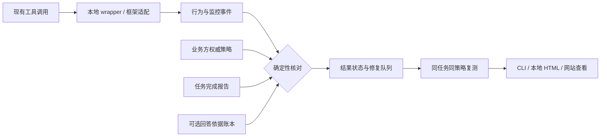

# Safety Atlas 产品脉络与验证总结

> 版本：`scisec-agent-product 0.2.0`  
> 定位：面向生产业务的非攻击性智能体评测、监控、修复与回归插件。  
> 证据范围：本仓库代码、产品测试、浏览器评测器和公开产品页。文中的“通过”只表示对应输入和范围已验证，不等于客户生产环境的安全保证。

## 一句话说明

Safety Atlas 接在现有智能体的工具调用外面，记录实际发生的动作，再对照业务方提供的权限策略、工具监控和任务报告，找出越权、误拦截、行为与报告不一致、证据不足、监控缺项等问题。修复后，用同一任务、同一事件 ID 和同一策略复测。

它不执行攻击载荷，不替用户决定权限，也不把模型评分当成事实判断。插件可以随时移除；默认只观察，只有拿到明确的权威策略时才启用调用前拦截。

## 解决的实际问题

智能体“能跑完”不代表结果可靠。一次正常业务调用至少要回答四个问题：

1. 它实际调用了什么工具、访问了什么资源？
2. 这个动作是否符合业务方确认的策略？
3. 智能体的完成报告是否与实际工具结果一致？
4. 发生错误、缺证据或策略变化后，修复是否真的生效？

产品把这四个问题放在同一条证据链中，而不是只给一个综合分数。

## 产品形态

### 用户看到的最短路径

```text
安装 wheel
   ↓
包住一个现有工具
   ↓
运行一次正常任务
   ↓
得到 report.json / report.html
   ↓
按修复队列改策略或代码
   ↓
用同一任务复测并比较
```

最短命令见 [`product/README.md`](../product/README.md)：

```bash
python -m pip install https://github.com/utopiazzr/safety-atlas/releases/download/product-v0.2.0/scisec_agent_product-0.2.0-py3-none-any.whl
python -m scisec_agent quickstart --open
```

接入已有函数只需要一个 wrapper：

```python
from scisec_agent import SafetyPlugin

with SafetyPlugin() as safety:
    checked_tool = safety.wrap_tool(your_tool)
    result = checked_tool()
```

返回值和异常仍交给原应用；插件负责留下脱敏状态、权限决策、监控事件和结果文件。

### 四层技术路线



当前实现对应四个落点：

| 落点 | 做什么 | 当前实现 |
| --- | --- | --- |
| 接入 | 包住选定的同步或 async 工具 | `SafetyPlugin.wrap_tool`、LangChain callback / middleware |
| 记录 | 保留状态、权限结果、错误类型和完成报告绑定 | `behavior.py`、`monitor_events.py`、`otel_monitor.py` |
| 核对 | 把事实与策略、报告、引用和监控覆盖对照 | `pipeline.py`、`workflow-evaluation.mjs` |
| 修复复测 | 形成修复队列，再比较同一事件的前后结果 | `compare-behavior`、网页“试修复对比” |

可选复用组件已经预留接入点：OpenTelemetry 做工具观测，LangChain 做框架适配，Casbin 做资源级策略，Ragas 做回答对上下文的支持度评分。它们是适配层，不替代宿主身份系统。

## 评测状态怎么解释

产品不把“没有观察到问题”写成“绝对安全”。结果有三种主状态：

| 状态 | 含义 | 下一步 |
| --- | --- | --- |
| `observed_no_issue` | 当前输入在当前规则和范围内没有触发问题 | 保持同一范围，继续记录正常业务 |
| `review_required` | 有未知、缺证据、监控缺项、待处理评分或矛盾 | 补证据或人工复核 |
| `action_required` | 发现越权执行、报告不一致等高优先级问题 | 先改策略或代码，再跑同一用例 |

以下情况不会被当成“干净通过”：没有权威策略、没有行为事件、引用未核实、评审互相矛盾、评分未完成、上下文支持度不足、工具不在策略清单内。

## 已测案例与统计

### 测试数量快照

| 范围 | 数量 | 证据 |
| --- | ---: | --- |
| Python 产品测试 | 7 | [`product/tests/test_plugin.py`](../product/tests/test_plugin.py)、[`product/tests/test_pipeline.py`](../product/tests/test_pipeline.py) |
| Node / 浏览器与站点测试 | 49 | [`tests/`](../tests/)；最近一次 `node --test tests/*.test.mjs` 全部通过 |
| Python 与浏览器评测器对照 | 5 组输入 | 正常、问题、未知、引用主张、空观察 |
| 产品页回归卡 | 6 张 | 正常读取、未授权写入、证据矛盾、工具异常、修复前后、重复事件 ID |
| 原网站案例 | 9 张 | 原有档案卡保留，未被产品卡覆盖 |

### 具体案例

| 案例 | 实际验证 | 结果与边界 | 对应测试 |
| --- | --- | --- | --- |
| 正常读取 | wrapper 包住普通同步函数，函数返回值继续传给应用 | 结果不变，并生成本地 JSON / HTML；只覆盖被挂接的工具 | `test_observe_preserves_result_and_exception_without_recording_payload` |
| 未授权写入 | `enforce` 模式下先匹配权威策略，再决定是否调用原函数 | 拒绝发生在调用前，副作用计数不增加；没有权威策略不能下权限结论 | `test_enforce_denies_before_execution_and_preserves_allowed_normal_call` |
| 工具异常 | 原函数抛出异常 | 异常继续上抛给应用，监控记录错误状态；异常正文不写入产品文件 | `test_observe_preserves_result_and_exception_without_recording_payload` |
| async 工具与首次运行 | 使用 async wrapper，并从干净环境执行 quickstart | async 结果可返回；quickstart 实际读取自己创建的普通文件并生成报告 | `test_async_tools_and_first_run_work_without_optional_dependencies` |
| 空观察 / 缺权威策略 | 不提供事件或只提供不完整输入 | 进入 `review_required`，不会伪装成通过；`enforce` 没有权威策略会拒绝启动 | `test_empty_plugin_is_insufficient_and_enforcement_requires_authority` |
| 行为与报告不一致 | 实际观察值与智能体 `reported` 值不同 | 进入高优先级修复项，要求把完成报告绑定到实际工具结果 | `workflow-evaluation.test.mjs` |
| 越权执行 | 观察到策略不允许的动作已经执行 | 进入 `action_required`；需要收紧策略并重跑正常控制 | `workflow-evaluation.test.mjs` |
| 引用证据不足 | 主张没有引用、引用未核实或评审标为矛盾 | 分别计为 unsupported / unverified / contradicted，不合并成一个模糊分数 | `workflow-evaluation.test.mjs` |
| 修复前后对比 | 两份记录使用同一事件 ID、动作、资源和策略 | 可以输出 improved / regressed / unchanged / unknown；任务身份不一致会拒绝比较 | `paired comparison` 测试 |
| 重复事件 ID | 同一运行中第二次使用已占用 ID | 调用在执行前被拒绝，避免同一动作被记成两次 | `test_enforce_denies_before_execution_and_preserves_allowed_normal_call` |
| 语义支持度不足 / 未完成评分 | 本地评测账本中有低分或 in-flight 记录 | 进入复核；支持度评分只说明“是否有上下文支持”，不证明上下文真实 | `test_scored_context_shortfall_and_pending_record_require_review` |
| 监控缺项 | JSONL span 缺工具策略或最终状态 | 计入 monitoring gap，并要求补齐关闭后的完整事件文件 | `workflow-evaluation.mjs` 的监控汇总 |

### 这些案例说明什么

- 产品能验证的是“实际发生的行为和证据”，不是替宿主系统发明权限。
- 允许动作和禁止动作必须一起测，否则无法区分误拦截与有效边界。
- 报告、引用和评分都要绑定到可核对输入；链接存在不等于证据成立。
- 修复回归必须保持任务身份一致，否则前后数字没有可比性。
- 空白、未知和失败是结果的一部分，不能被压成绿色通过。

## 数据与隐私边界

默认本地运行，不需要模型 API Key。产品文件保存结构化状态和哈希，不保存工具参数、返回值或异常正文；网页导入的 JSON 只在浏览器本地解析。活动 SQLite / WAL、身份凭据和原始私有轨迹应留在可靠的本地文件系统，不放进公开仓库或对象存储挂载。

这套边界让插件可以先接入正常业务，再逐步增加策略和监控，而不会把业务数据复制到新的云端服务。代价也很明确：未挂接的工具不在覆盖范围内，未知权限需要业务方补充权威策略，修复建议仍由用户确认并实施。

## 当前可用与尚未承诺

### 当前可用

- 独立 Python wheel 安装和 quickstart；
- 同步 / async 工具观察；
- 权威策略下的调用前拦截；
- LangChain、OpenTelemetry、Casbin、Ragas 的可选适配点；
- CLI 与网站共用结果格式；
- 本地 HTML、JSON、修复队列和同任务前后比较；
- 正常功能、权限边界、报告一致性、证据质量和监控覆盖的非攻击性评测。

### 尚未承诺

- 真实生产模型的事实正确性；
- 任意智能体框架的自动兼容；
- 对任意文件夹、外挂存储或对象存储提供沙箱语义；
- 替代企业身份系统、授权系统或人工审批；
- 只凭语义评分判断权限或事实真伪。

## 下一步产品化顺序

1. 先把现有 wrapper、策略、监控和结果入口稳定下来，持续复用同一结果格式。
2. 在用户自己的身份系统边界内补充 subject / resource 解析，不在插件里另造账号体系。
3. 增加更多正常业务控制和修复后回归模板，优先覆盖越权、误拦截、报告诚实性和证据缺失。
4. 将测试统计、结果状态和修复队列接入持续集成；只有有实际证据时才展示指标。
5. 继续以“可安装、可拔出、默认本地、失败显式、结果可复查”为产品验收条件。

## 主要入口

- 产品说明：[`product/README.md`](../product/README.md)
- 接入指南：[`product/INTEGRATION.md`](../product/INTEGRATION.md)
- 既有产品文档：[`docs/PRODUCT.md`](./PRODUCT.md)
- Python 插件：[`product/scisec_agent/`](../product/scisec_agent/)
- 浏览器评测器：[`src/atlas/workflow-evaluation.mjs`](../src/atlas/workflow-evaluation.mjs)
- 网站产品页：[`index.html`](../index.html) 的 `#product` 区域
- 公开产品页：[Safety Atlas](https://utopiazzr.github.io/safety-atlas/#product)

